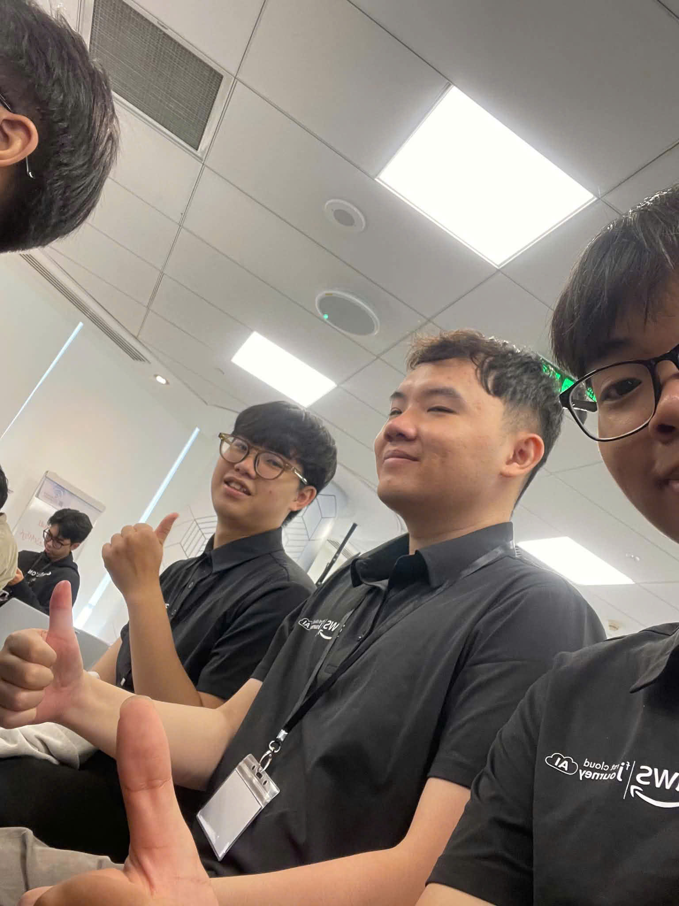

# Event Summary Report: “Buildrathon Kickoff: Code the Future with CMC Global”

- **Event Name:** Buildrathon Kickoff: Code the Future with CMC Global  
- **Date & Time:** 09:00 – 12:00, September 26, 2026  
- **Location:** 26th Floor, Bitexco Financial Tower, 2 Hai Trieu Street, District 1, Ho Chi Minh City, Vietnam  
- **Role:** Attendee  

### Event Objectives

- Grasp the Buildathon format, core goals, and evaluation rubric prior to kicking off the competition.
- Build a foundational understanding of AWS Cloud, Generative AI, and the architecture of modern AI Agents on AWS.
- Network with fellow builders, exchange backgrounds and technical interests in AWS and AI, and prepare for team formation.
- Gain industry insights from AWS practitioners and tech leaders regarding cloud adoption, AI trends, real-world use cases, and career pathways.
- Get hands-on experience designing a prototype AI solution on AWS during a mentor-guided mini challenge.

### Speakers

- **Industry Practitioners, AWS Specialists, Guest Speakers, and Technical Mentors** supporting the Buildathon program.

### Key Highlights

#### Buildathon Orientation & Challenge Framing

- Walked through the competition structure, problem scope, and judging criteria to align expectations from day one.
- Covered core concepts around **AWS Cloud**, **Generative AI**, and how autonomous **AI Agents** are orchestrated using AWS services.

#### Networking & Team Ice-Breaking

- Facilitated interactive ice-breaking activities to help attendees connect and discover potential teammates.
- Encouraged participants to share their technical strengths and interests in Cloud and AI to streamline collaboration during the challenge.

#### Panel Talkshow & Q&A – Career Pathways in Cloud & AI

- Discussed emerging cloud computing trends, enterprise AI adoption, real-world production projects, and career growth opportunities.
- Highlighted how enterprises leverage **AWS** and **Agentic AI** to solve complex operational challenges and accelerate innovation.
- Addressed participant questions during an open Q&A covering **AWS certifications**, **Generative AI** skillsets, career development, and practical tips for the Buildathon.

#### Hands-on Lab – AI Agent Mini Challenge

- Translated theory into practice by building an AI-powered prototype on AWS with direct guidance from technical mentors.
- Explored practical building blocks including **prompt engineering**, **retrieval-augmented generation (RAG)**, **knowledge bases**, and **AI agents**.

#### Wrap-Up & Community Closing

- Summarized key takeaways, shared curated AWS learning resources, announced upcoming community sessions, and captured group photos.

### Key Takeaways

#### Problem-Solving & Architecture Mindset

- **Align with goals and judging criteria early**: Establishing a clear understanding of evaluation metrics upfront keeps technical design focused on high-impact features.
- **Core building blocks of AI Agents**: Learned how prompt engineering, RAG pipelines, knowledge bases, and AWS managed services integrate into cohesive AI solutions.

#### Career Growth & Teamwork

- **Bridging learning with industry practice**: Connecting hands-on AWS experimentation with real-world project patterns, certifications, and long-term career planning.
- **Early peer alignment**: Building rapport and aligning on technical interests early sets a strong foundation for effective teamwork.

### Application to My Work

- **Adopt RAG and Knowledge Base patterns**: Integrate retrieval-augmented generation and structured knowledge bases when architecting AI-driven applications on AWS.
- **Define success criteria upfront**: Clarify project scope, constraints, and evaluation benchmarks before writing code.
- **Foster proactive team collaboration**: Carry forward structured communication and mentor-feedback habits from the kickoff into my team's capstone project.

### Personal Experience & Reflection

Attending **“Buildrathon Kickoff: Code the Future with CMC Global”** provided a structured, motivating launchpad for the Buildathon and practical AI development on AWS. Key highlights from my experience include:

#### Insights from Industry Practitioners
- Hearing directly from AWS practitioners and industry leaders clarified how **AWS** and **Agentic AI** are deployed in real business environments rather than just theoretical demos.
- The open Q&A offered actionable guidance on navigating **AWS certifications**, building a cloud/AI portfolio, and avoiding common pitfalls during hackathons.

#### Practical Hands-On Exposure
- Participating in the **AI Agent Mini Challenge** helped solidify abstract concepts like **prompt engineering**, **RAG**, **knowledge bases**, and **AI agents** through real implementation.
- Having mentors available to troubleshoot and refine ideas made the rapid prototyping process much smoother.

#### Peer Networking
- The **ice-breaking** session created an open environment to meet fellow builders, compare technical backgrounds, and prepare for collaborative team execution.

#### Core Lessons Learned
- Starting with clear objectives and evaluation criteria prevents scope creep and keeps development focused.
- Iterative hands-on experimentation backed by mentor feedback is the fastest way to turn Generative AI concepts into working prototypes.

#### Event Photos

> In summary, the kickoff event combined clear competition framing, practical AWS AI insights, hands-on prototyping, and valuable peer connections to set a strong foundation for the weeks ahead.
