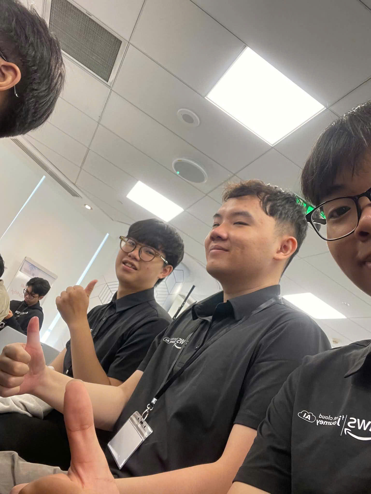

# Báo cáo tổng kết sự kiện: “Buildrathon Kickoff: Code the Future with CMC Global”

- **Tên sự kiện:** Buildrathon Kickoff: Code the Future with CMC Global  
- **Thời gian:** 09:00 – 12:00, ngày 26/09/2026  
- **Địa điểm:** Tầng 26, Tòa nhà Bitexco Financial Tower, Số 2 Hải Triều, Quận 1, TP. Hồ Chí Minh, Việt Nam  
- **Vai trò:** Người tham dự  

### Mục tiêu sự kiện

- Nắm bắt cấu trúc cuộc thi Buildathon, mục tiêu trọng tâm và bộ tiêu chí chấm điểm trước khi bước vào giai đoạn triển khai.
- Xây dựng cái nhìn hệ thống về AWS Cloud, Generative AI và kiến trúc phát triển các AI Agent hiện đại trên nền tảng AWS.
- Giao lưu với cộng đồng người tham dự, chia sẻ thế mạnh chuyên môn về AWS và AI để chuẩn bị cho quá trình làm việc nhóm.
- Lắng nghe chia sẻ thực tiễn từ các chuyên gia công nghệ và AWS practitioners về xu hướng đám mây, ứng dụng AI trong doanh nghiệp và định hướng nghề nghiệp.
- Trực tiếp thực hành xây dựng giải pháp AI trên AWS thông qua mini challenge dưới sự hướng dẫn của đội ngũ mentor.

### Diễn giả

- **Các chuyên gia công nghệ, AWS practitioners, diễn giả khách mời và đội ngũ mentor** đồng hành cùng chương trình Buildathon.

### Nội dung nổi bật

#### Khởi động Buildathon & Định hình thử thách

- Giới thiệu chi tiết thể lệ cuộc thi Buildathon, phạm vi bài toán và các tiêu chí đánh giá giải pháp.
- Hệ thống hóa kiến thức nền tảng về **AWS Cloud**, **Generative AI** và cách điều phối **AI Agents** bằng hệ sinh thái dịch vụ AWS.

#### Kết nối & Làm quen đội nhóm (Ice-breaking)

- Tổ chức hoạt động giao lưu giúp người tham dự mở rộng mạng lưới kết nối và tìm kiếm đồng đội phù hợp.
- Khuyến khích các thành viên chia sẻ nền tảng kỹ thuật và định hướng quan tâm trong lĩnh vực Cloud/AI để sẵn sàng phối hợp hiệu quả.

#### Talkshow & Q&A – Định hướng sự nghiệp trong kỷ nguyên Cloud & AI

- Chia sẻ góc nhìn thực tế về xu hướng điện toán đám mây, bài toán triển khai AI thực tế và cơ hội phát triển nghề nghiệp.
- Phân tích cách các doanh nghiệp ứng dụng **AWS** và **Agentic AI** để tối ưu vận hành và tạo ra giá trị đổi mới.
- Giải đáp trực tiếp các thắc mắc trong phiên Q&A xoay quanh lộ trình học **AWS**, chứng chỉ chuyên môn, kỹ năng **Generative AI** và kinh nghiệm tham gia Buildathon.

#### Thực hành – AI Agent Mini Challenge

- Vận dụng kiến thức vừa tiếp thu để xây dựng nguyên mẫu giải pháp AI trên AWS thông qua mini challenge có mentor hỗ trợ sát sao.
- Trực tiếp làm việc với các thành phần cốt lõi như **prompt engineering**, **retrieval-augmented generation (RAG)**, **knowledge bases** và **AI agents**.

#### Tổng kết & Giao lưu cộng đồng

- Đúc kết các nội dung trọng tâm của buổi kickoff, cung cấp tài nguyên học tập hữu ích, giới thiệu các hoạt động tiếp theo và chụp ảnh lưu niệm cùng cộng đồng.

### Bài học cốt lõi

#### Tư duy giải quyết bài toán & Thiết kế giải pháp

- **Bám sát mục tiêu và tiêu chí chấm điểm ngay từ đầu**: Hiểu rõ thước đo đánh giá giúp đội ngũ tập trung nguồn lực vào các tính năng mang lại giá trị cốt lõi.
- **Kiến trúc nền tảng của AI Agent**: Hiểu rõ sự kết hợp giữa prompt engineering, luồng dữ liệu RAG, knowledge bases và các dịch vụ AWS khi xây dựng ứng dụng AI thực tế.

#### Phát triển nghề nghiệp & Phối hợp nhóm

- **Gắn kết thực hành với nhu cầu doanh nghiệp**: Kết nối việc tự nghiên cứu AWS với bài toán thực tiễn, lộ trình thi chứng chỉ và mục tiêu nghề nghiệp dài hạn.
- **Kết nối sớm để phối hợp ăn ý**: Việc làm quen và thống nhất định hướng chuyên môn ngay từ đầu giúp quá trình làm việc nhóm diễn ra suôn sẻ hơn.

### Áp dụng vào công việc thực tế

- **Ứng dụng mô hình RAG và Knowledge Bases**: Áp dụng các kỹ thuật này khi thiết kế và thử nghiệm các giải pháp ứng dụng AI trên AWS.
- **Xác định rõ tiêu chí thành công trước khi triển khai**: Làm rõ yêu cầu bài toán và chuẩn đầu ra trước khi bắt tay vào lập trình.
- **Duy trì tinh thần trao đổi cởi mở trong nhóm**: Đưa thói quen giao tiếp chủ động và tận dụng phản hồi từ mentor vào quá trình thực hiện đồ án nhóm.

### Trải nghiệm cá nhân

Buổi tham dự **“Buildrathon Kickoff: Code the Future with CMC Global”** đã mang lại một khởi đầu bài bản và nhiều động lực cho mình trong hành trình chinh phục Buildathon cũng như phát triển ứng dụng AI trên AWS. Một số trải nghiệm đáng nhớ gồm:

#### Học hỏi từ góc nhìn thực chiến
- Những chia sẻ từ các AWS practitioners và chuyên gia trong ngành giúp mình hình dung rõ cách **AWS** và **Agentic AI** được đưa vào vận hành thực tế tại doanh nghiệp thay vì chỉ dừng ở mức lý thuyết.
- Phiên Q&A giúp tháo gỡ nhiều băn khoăn về lộ trình chinh phục **chứng chỉ AWS**, cách xây dựng năng lực **Generative AI** và chiến lược phân bổ thời gian trong cuộc thi.

#### Trải nghiệm thực hành trực tiếp
- Phần thực hành **AI Agent Mini Challenge** giúp mình chuyển hóa các khái niệm như **prompt engineering**, **RAG**, **knowledge bases** và **AI agents** thành sản phẩm chạy thực tế trên AWS.
- Sự hướng dẫn kịp thời của mentor trong lúc thử nghiệm giúp mình nhanh chóng nắm bắt cách xử lý vấn đề và tối ưu ý tưởng.

#### Mở rộng kết nối cộng đồng
- Hoạt động **ice-breaking** tạo không khí cởi mở để làm quen với nhiều bạn có cùng đam mê **AWS** và **AI**, tạo tiền đề tốt cho việc hợp tác nhóm.

#### Đúc kết kinh nghiệm
- Việc xác định rõ mục tiêu và tiêu chí đánh giá ngay từ vạch xuất phát giúp giữ đúng trọng tâm trong suốt quá trình phát triển.
- Thực hành liên tục kết hợp với góc nhìn phản biện từ mentor là cách hiệu quả nhất để biến kiến thức **Generative AI** thành giải pháp thực tiễn.

#### Hình ảnh tại sự kiện

> Nhìn chung, sự kiện không chỉ giúp mình nắm rõ luật chơi của Buildathon và kiến thức nền tảng về AWS AI, mà còn mang lại trải nghiệm thực hành giá trị cùng những kết nối đồng đội chất lượng cho chặng đường sắp tới.
