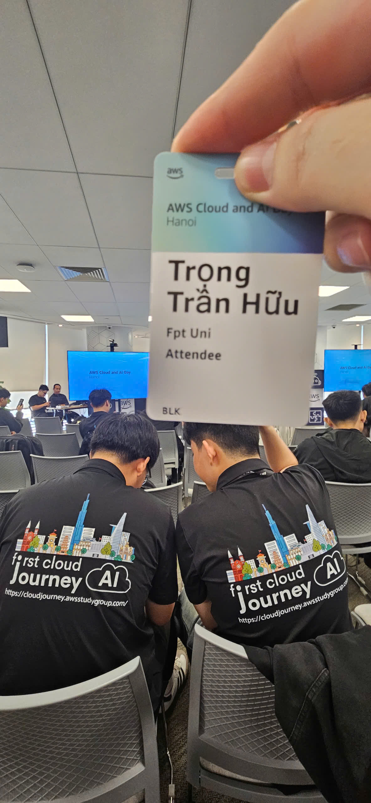

# Event Summary Report: “AWS Cloud & AI Day Hanoi 2026”

- **Event Name:** AWS Cloud & AI Day Hanoi 2026
- **Date & Time:** 09:00 – 17:00, September 29, 2026
- **Location:** 26th Floor, Bitexco Financial Tower, 2 Hai Trieu Street, District 1, Ho Chi Minh City, Vietnam
- **Role:** Attendee

### Event Objectives

- Understand the transition of cloud computing, Generative AI, and Agentic AI from early experimentation to production-ready enterprise systems.
- Examine modern practices in cloud-native engineering, infrastructure automation, data platforms, workload identity, cloud security, and AI governance.
- Learn directly from Vietnamese enterprise customer stories on modernizing legacy architectures and operating reliably at scale.
- Analyze how security controls, governance frameworks, observability, and human oversight must adapt as AI systems gain autonomy.
- Map the technical insights from the event to my personal focus on cybersecurity and cloud security engineering.

### Speakers

- **Dr. Werner Vogels** – Chief Technology Officer, Amazon.com (Keynote Speaker)
- **Eric Yeo** – Country General Manager for Malaysia, Vietnam & Indochina, AWS
- **Mai Le** – Director of Product Management, Katalon
- **Dr. Jens Lottner** – Chief Executive Officer, Techcombank
- **AWS Solutions Architects, Engineers, and Industry Leaders** from Katalon, Techcombank, TCBS, Techcom Life, VPBank, and partner organizations

### Key Highlights

#### Evolution from Cloud-Native Architecture to Agentic AI

- Moving beyond basic lift-and-shift migrations toward automated, self-healing, cloud-native architectures powered by **containers**, **Kubernetes**, **serverless**, **event-driven patterns**, and **managed services**.
- **Platform Engineering** and **Internal Developer Platforms (IDPs)** establish standardized **“Golden Paths”** that eliminate repetitive infrastructure toil and **TicketOps** delays.
- Tools including **Amazon EKS**, **Crossplane**, **Terragrunt**, **Backstage**, **FluxCD**, and **GitOps** workflows ensure reproducible, consistent, auditable, and policy-controlled infrastructure delivery.

#### Operationalizing Agentic AI in Production

- Building a functional AI agent prototype is straightforward compared to running it safely at enterprise scale, which rests on four foundational pillars:
  - **Operational Excellence**: High availability, graceful failure recovery, latency budgets, and continuous monitoring.
  - **Data Governance**: Clear data ownership, freshness, integrity, and granular access authorization.
  - **Security & Trust**: Strict enforcement of workload identities, tool permissions, and sensitive data isolation.
  - **Human Oversight**: Retaining human-in-the-loop approval for high-impact or irreversible operations.
- Technical deep dives on **Amazon Bedrock**, **Amazon Bedrock AgentCore**, **Strands Agents**, **Model Context Protocol (MCP)**, the **ReAct** reasoning loop, state persistence, and tool orchestration demonstrated how agents reason, retrieve context, invoke tools, and operate within explicit authorization guardrails.

#### Workload Identity, Least Privilege, and AI Security

- Advancing past static, long-lived access keys toward cryptographically verifiable **workload identities** across trust boundaries.
- Core building blocks covered: **AWS IAM**, **AWS STS** (ephemeral credentials and short-lived sessions), **trust policies**, **session policies and session tags**, **source identity**, and **Attribute-Based Access Control (ABAC)** across **EC2**, **ECS/Fargate**, **Lambda**, **EKS**, **CI/CD pipelines**, multi-account environments, and **AI agents**.

#### AI Governance, Data Provenance, and Trust

- Enterprise AI success hinges as much on data engineering and governance as on model selection—requiring data accuracy, freshness, lineage, ownership, access controls, grounded evidence, decision traceability, and safeguards against unsafe agent outputs.
- Summarized along the end-to-end security lifecycle: **Identity → Data → Model → Tools → Agent → Action → Audit**.

#### Security Observability for AI Workloads

- Expanding traditional infrastructure telemetry (**Four Golden Signals**: Latency, Errors, Traffic, Saturation) with AI-specific observability pillars:
  - **Cost**: Token consumption tracking and anomaly detection for runaway usage.
  - **Safety**: PII leakage prevention, prompt injection detection, and unauthorized tool invocation blocking.
  - **Quality**: Hallucination detection and output accuracy verification.
- Unifying infrastructure logs, IAM/identity events, data access trails, and AI agent behavioral telemetry.

#### Secure AI-Assisted Software Development

- **Kiro** and **AI-DLC** embed AI across the entire Software Development Life Cycle—from architecture planning and code generation to automated testing, documentation, technical-debt reduction, and legacy modernization—highlighted by **TCBS** achieving a **26%** reduction in development time.
- Emphasized pairing AI coding velocity with automated security checks, human code review, governance policies, and **DevSecOps** guardrails.

#### Enterprise Cloud Modernization & Regulatory Compliance

- Real-world case studies from **Techcombank**, **Techcom Life**, **TCBS**, **VPBank**, and **Katalon** showcased application and database modernization, container adoption, unified data platforms, automated observability, and operational resilience.
- Highlighted **AWS Local Zone in Hanoi** and **AWS Outposts (2nd Generation)** for meeting strict Vietnamese data-residency and regulatory mandates while balancing **Security, Compliance, Reliability, Performance, Cost, and Business Agility**.

### Key Takeaways

#### Security Engineering Mindset

- **Identity as the primary perimeter**: Every compute workload, CI/CD pipeline, microservice, and AI agent must operate with a distinct identity and ephemeral, least-privilege credentials.
- **End-to-end AI security and human-in-the-loop controls**: Safeguard the full execution chain (**Identity → Data → Model → Tools → Agent → Action → Audit**) and enforce human approval before high-risk actions execute.
- **Holistic AI observability**: Track agent reasoning, tool calls, data access, safety guardrails, output quality, and token spend alongside conventional system metrics.

#### Cloud & Platform Architecture

- **Declarative, auditable infrastructure**: Favor managed services, containers, Kubernetes, serverless, **GitOps**, and **IDPs** over ad-hoc manual changes.
- **Unified identity and data governance**: Combine **IAM**, **STS**, workload identity, **ABAC**, cross-account boundaries, and curated data lineage.

#### AI & Cybersecurity Convergence

- **Verifiable safety over raw model capability**: Validate that AI agents act strictly within authorized identities, permissions, and grounded data to mitigate emerging attack vectors (prompt injection, sensitive data exposure, privilege escalation, unauthorized tool execution, hallucinations, and cost spikes).
- **Cross-disciplinary integration**: Bridges **Cloud Security**, **DevSecOps**, **AI Security**, and **Security Operations (SecOps)**.

### Application to My Work

- **Enforce least-privilege IAM and short-lived sessions**: Build hands-on labs practicing **AWS IAM**, **STS** role assumption, trust policies, **ABAC**, and cross-account access, verifying session tags in CloudTrail audit logs.
- **Build unified cloud and AI security monitoring**: Correlate infrastructure telemetry, identity logs, and AI agent activity, exploring how **Wazuh** and **SIEM** workflows extend into cloud-native and AI environments.
- **Apply GitOps, IaC, and strict agent guardrails**: Maintain version-controlled, auditable infrastructure and enforce explicit identity, permission, data-access, logging, and human-approval boundaries when building AI agents.
- **Preserve human review in AI-assisted workflows**: Leverage AI developer tools to accelerate delivery while maintaining rigorous security validation and human sign-off.

### Personal Experience & Reflection

Attending the **“AWS Cloud & AI Day Hanoi 2026”** watch party and workshop offered a comprehensive look at how cloud-native platforms, agentic AI, and enterprise security converge in real production environments. Key highlights from my experience include:

#### Learning from Enterprise Leaders
- Sessions led by AWS executives and Vietnamese enterprise leaders (**Techcombank**, **TCBS**, **VPBank**, **Techcom Life**, and **Katalon**) demonstrated how large organizations balance rapid cloud and AI modernization with strict regulatory compliance, operational stability, and cultural transformation.
- Concrete production case studies bridged high-level architectural concepts with real-world operational constraints.

#### Broad Technical Exposure
- Gained structured exposure to **Amazon EKS**, **Kubernetes**, **GitOps**, **IAM**, **STS**, **Amazon Bedrock**, **AgentCore**, **MCP**, **AI-DLC**, data governance, and **AI security observability**.
- Strengthened my understanding of workload identity, least-privilege enforcement, infrastructure-as-code automation, and monitoring AI safety, quality, and cost.

#### Core Lessons Learned
- Scaling automation without strong governance amplifies security risks just as quickly as it boosts engineering velocity.
- Greater AI autonomy demands stricter identity boundaries, verifiable authorization, trusted data pipelines, and continuous lifecycle governance.
- Modern security engineers must be equipped not only to detect external threats, but also to architect, monitor, and govern AI systems safely.

#### Event Photos

> Overall, the event delivered rich architectural and security insights that directly shaped my approach to cloud security, AI governance, observability, and building safe, human-supervised AI systems.
