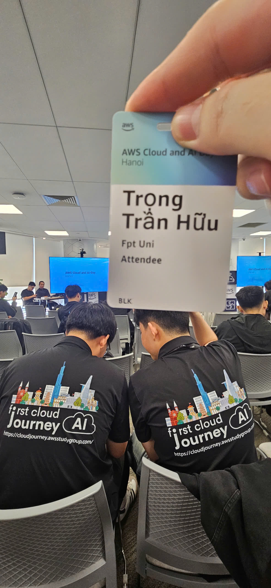

# Báo cáo tổng kết sự kiện: “AWS Cloud & AI Day Hanoi 2026”

- **Tên sự kiện:** AWS Cloud & AI Day Hanoi 2026
- **Thời gian:** 09:00 – 17:00, ngày 29/09/2026
- **Địa điểm:** Tầng 26, Tòa nhà Bitexco Financial Tower, Số 2 Hải Triều, Quận 1, TP. Hồ Chí Minh, Việt Nam
- **Vai trò:** Người tham dự

### Mục tiêu sự kiện

- Nắm bắt bức tranh chuyển dịch của điện toán đám mây, Generative AI và Agentic AI từ giai đoạn thử nghiệm sang triển khai thực tế ở quy mô doanh nghiệp.
- Khám phá các phương pháp tiếp cận hiện đại về kiến trúc cloud-native, tự động hóa hạ tầng, nền tảng dữ liệu, định danh workload (workload identity), bảo mật đám mây và quản trị AI.
- Học hỏi kinh nghiệm thực tiễn từ các doanh nghiệp lớn tại Việt Nam trong quá trình hiện đại hóa hệ thống lõi và vận hành ổn định ở quy mô lớn.
- Phân tích cách thức bảo mật, quản trị (governance), khả năng quan sát (observability) và sự giám sát của con người (human oversight) cần tiến hóa khi các hệ thống AI ngày càng tự chủ.
- Liên hệ các kiến thức chuyên sâu tại sự kiện với lộ trình phát triển cá nhân trong lĩnh vực an toàn thông tin (cybersecurity) và bảo mật đám mây (cloud security).

### Diễn giả

- **Dr. Werner Vogels** – Giám đốc Công nghệ (CTO), Amazon.com (Diễn giả chính - Keynote)
- **Eric Yeo** – Tổng Giám đốc AWS khu vực Malaysia, Việt Nam & Đông Dương
- **Mai Le** – Giám đốc Quản lý Sản phẩm (Director of Product Management), Katalon
- **Dr. Jens Lottner** – Tổng Giám đốc (CEO), Techcombank
- **Các chuyên gia kiến trúc giải pháp, kỹ sư AWS và lãnh đạo công nghệ** từ Katalon, Techcombank, TCBS, Techcom Life, VPBank cùng nhiều doanh nghiệp đối tác

### Nội dung nổi bật

#### Chuyển dịch từ Kiến trúc Cloud-Native sang Agentic AI

- Bước chuyển từ mô hình đưa hạ tầng lên mây đơn thuần sang xây dựng các hệ thống cloud-native tự động hóa và tự chủ cao dựa trên **containers**, **Kubernetes**, **serverless**, **kiến trúc hướng sự kiện (event-driven)** và **managed services**.
- **Platform Engineering** và **Internal Developer Platforms (IDPs)** thiết lập các **“Golden Paths”** chuẩn hóa, giúp giảm thiểu thao tác vận hành thủ công và xóa bỏ điểm nghẽn **TicketOps**.
- Các công nghệ như **Amazon EKS**, **Crossplane**, **Terragrunt**, **Backstage**, **FluxCD** và quy trình **GitOps** đảm bảo việc cung cấp hạ tầng và triển khai ứng dụng có tính tái lập, nhất quán, dễ truy vết và kiểm soát chặt chẽ.

#### Đưa Agentic AI từ Thử nghiệm (PoC) vào Vận hành Thực tế (Production)

- Việc xây dựng một nguyên mẫu AI agent đơn giản hơn nhiều so với việc vận hành an toàn trong môi trường production, đòi hỏi sự vững chắc trên bốn trụ cột:
  - **Operational Excellence (Vận hành xuất sắc)**: Độ sẵn sàng cao, cơ chế phục hồi lỗi, kiểm soát độ trễ và giám sát liên tục.
  - **Data Governance (Quản trị dữ liệu)**: Xác định rõ quyền sở hữu dữ liệu, độ tươi mới, tính toàn vẹn và phân quyền truy cập chi tiết.
  - **Security & Trust (Bảo mật & Tin cậy)**: Kiểm soát chặt chẽ danh tính, quyền gọi công cụ (tools) và bảo vệ thông tin nhạy cảm.
  - **Human Oversight (Giám sát của con người)**: Duy trì cơ chế con người phê duyệt đối với các hành động có tác động lớn hoặc không thể đảo ngược.
- Các phiên chuyên đề về **Amazon Bedrock**, **Amazon Bedrock AgentCore**, **Strands Agents**, **Model Context Protocol (MCP)**, mô hình suy luận **ReAct**, quản lý trạng thái và tích hợp công cụ đã minh họa cách agent suy luận, truy xuất ngữ cảnh, gọi tool và hành động trong giới hạn phân quyền rõ ràng.

#### Định danh Workload, Đặc quyền Tối thiểu và Bảo mật AI

- Tiến xa hơn việc loại bỏ khóa truy cập dài hạn (long-lived access keys) sang áp dụng **workload identity** có khả năng xác thực xuyên suốt các ranh giới tin cậy (trust boundaries).
- Các cơ chế trọng tâm gồm: **AWS IAM**, **AWS STS** (thông tin xác thực ngắn hạn và session tạm thời), **trust policies**, **session policies & session tags**, **source identity**, và phân quyền dựa trên thuộc tính (**ABAC**) cho **EC2**, **ECS/Fargate**, **Lambda**, **EKS**, **CI/CD**, môi trường đa tài khoản và **AI agents**.

#### Quản trị AI, An toàn Dữ liệu và Niềm tin Hệ thống

- Thành công của AI trong doanh nghiệp phụ thuộc vào bài toán dữ liệu và quản trị không kém gì việc chọn mô hình: bao gồm độ chính xác, tính cập nhật, nguồn gốc dữ liệu (lineage), quyền sở hữu, phân quyền truy cập, câu trả lời có dẫn chứng, khả năng truy vết và ngăn chặn các quyết định thiếu an toàn của agent.
- Khái quát hóa thành chuỗi bảo mật xuyên suốt: **Identity → Data → Model → Tools → Agent → Action → Audit**.

#### Khả năng Quan sát Bảo mật (Security Observability) cho Ứng dụng AI

- Mở rộng hệ thống giám sát hạ tầng truyền thống (**Four Golden Signals**: Latency, Errors, Traffic, Saturation) với các chiều đo lường đặc thù của AI:
  - **Cost (Chi phí)**: Theo dõi lượng token tiêu thụ và cảnh báo mức sử dụng bất thường.
  - **Safety (An toàn)**: Phát hiện rò rỉ dữ liệu cá nhân (PII), tấn công prompt injection và ngăn chặn gọi công cụ trái phép.
  - **Quality (Chất lượng)**: Kiểm soát hiện tượng ảo giác (hallucination) và đánh giá độ chính xác của đầu ra.
- Hợp nhất dữ liệu telemetry hạ tầng, nhật ký định danh, lịch sử truy cập dữ liệu và hành vi hoạt động của AI agent.

#### Phát triển Phần mềm Hỗ trợ bởi AI An toàn

- **Kiro** và **AI-DLC** tích hợp AI xuyên suốt vòng đời phát triển phần mềm (SDLC) — từ phân tích thiết kế, sinh mã, kiểm thử tự động, viết tài liệu, xử lý nợ kỹ thuật đến hiện đại hóa hệ thống cũ — điển hình là case study của **TCBS** giúp rút ngắn **26%** thời gian phát triển.
- Nhấn mạnh việc kết hợp tốc độ phát triển của AI với quy trình rà soát bảo mật, quản trị mã nguồn, phê duyệt của con người và tích hợp **DevSecOps**.

#### Hiện đại hóa Đám mây và Tuân thủ Quy định Doanh nghiệp

- Các câu chuyện thực tế từ **Techcombank**, **Techcom Life**, **TCBS**, **VPBank** và **Katalon** làm nổi bật quá trình hiện đại hóa ứng dụng/cơ sở dữ liệu, container hóa, hợp nhất nền tảng dữ liệu, tự động hóa giám sát và nâng cao khả năng phục hồi hệ thống.
- Giới thiệu **AWS Local Zone tại Hà Nội** và **AWS Outposts (thế hệ thứ hai)** giúp đáp ứng yêu cầu lưu trữ dữ liệu tại chỗ (data residency) và tuân thủ pháp lý tại Việt Nam, cân bằng hài hòa giữa **Bảo mật + Tuân thủ + Độ tin cậy + Hiệu năng + Chi phí + Sự linh hoạt kinh doanh**.

### Bài học cốt lõi

#### Tư duy Kỹ thuật Bảo mật

- **Định danh là ranh giới bảo mật tiên quyết**: Mọi workload, pipeline, dịch vụ và AI agent đều phải có danh tính tách biệt đi kèm quyền hạn tạm thời theo nguyên tắc đặc quyền tối thiểu.
- **Bảo mật toàn chuỗi AI và kiểm soát của con người**: Bảo vệ trọn vẹn luồng thực thi (**Identity → Data → Model → Tools → Agent → Action → Audit**) và duy trì bước phê duyệt của con người trước các tác vụ rủi ro cao.
- **Giám sát toàn diện hành vi AI**: Theo dõi luồng suy luận, lệnh gọi tool, truy cập dữ liệu, rào cản an toàn, chất lượng phản hồi và chi phí token song song với các chỉ số hệ thống truyền thống.

#### Kiến trúc Cloud & Nền tảng

- **Hạ tầng khai báo bằng mã và dễ kiểm toán**: Ưu tiên managed services, containers, Kubernetes, serverless, **GitOps** và **IDP** thay vì can thiệp thủ công.
- **Nền tảng định danh và dữ liệu vững chắc**: Kết hợp chặt chẽ **IAM**, **STS**, workload identity, **ABAC**, phân tách đa tài khoản và quản trị nguồn gốc dữ liệu.

#### Giao thoa giữa AI và An ninh mạng

- **Vận hành an toàn quan trọng hơn năng lực thuần túy**: Đánh giá xem AI agent có thực thi đúng danh tính, đúng quyền hạn và dựa trên dữ liệu tin cậy hay không trước các bề mặt tấn công mới (prompt injection, lộ lọt dữ liệu, leo thang đặc quyền, gọi tool trái phép, hallucination và bùng nổ chi phí).
- **Kết nối đa lĩnh vực chuyên môn**: Gắn kết **Cloud Security**, **DevSecOps**, **AI Security** và **Security Operations (SecOps)**.

### Áp dụng vào công việc thực tế

- **Thực hành IAM đặc quyền tối thiểu và session ngắn hạn**: Triển khai các bài lab về **AWS IAM**, **STS** assume role, trust policies, **ABAC** và truy cập đa tài khoản, đồng thời kiểm tra session tags trên nhật ký kiểm toán CloudTrail.
- **Mở rộng hệ thống giám sát bảo mật**: Kết hợp log hạ tầng, sự kiện định danh và nhật ký hoạt động của AI agent; nghiên cứu mở rộng **Wazuh** và **SIEM** sang giám sát môi trường cloud-native và AI.
- **Áp dụng GitOps, IaC và thiết lập ranh giới cho AI agent**: Quản lý mọi thay đổi hạ tầng qua mã nguồn có kiểm toán, đồng thời thiết lập ranh giới rõ ràng về danh tính, quyền hạn, truy cập dữ liệu, ghi log và phê duyệt của con người khi phát triển AI agent.
- **Duy trì bước kiểm duyệt của con người với công cụ AI**: Tận dụng công cụ AI hỗ trợ lập trình để tăng tốc độ phát triển nhưng luôn giữ quy trình kiểm thử bảo mật và xác nhận của con người.

### Trải nghiệm cá nhân

Tham dự chương trình **“AWS Cloud & AI Day Hanoi 2026”** mang lại cho mình cái nhìn toàn diện và thực tế về cách các kiến trúc cloud-native, agentic AI và hệ thống bảo mật doanh nghiệp vận hành ở quy mô lớn. Những trải nghiệm nổi bật gồm:

#### Học hỏi từ các chuyên gia và doanh nghiệp đầu ngành
- Phần chia sẻ từ lãnh đạo AWS cùng các doanh nghiệp lớn tại Việt Nam (**Techcombank**, **TCBS**, **VPBank**, **Techcom Life** và **Katalon**) cho thấy cách các tổ chức cân bằng giữa tốc độ hiện đại hóa công nghệ với yêu cầu tuân thủ pháp lý, độ ổn định vận hành và chuyển đổi văn hóa.
- Các case study thực tế giúp mình kết nối các khái niệm kiến trúc đám mây và AI với những bài toán vận hành thực tiễn.

#### Mở rộng kiến thức kỹ thuật chuyên sâu
- Tiếp cận có hệ thống các công nghệ như **Amazon EKS**, **Kubernetes**, **GitOps**, **IAM**, **STS**, **Amazon Bedrock**, **AgentCore**, **MCP**, **AI-DLC**, quản trị dữ liệu và **AI security observability**.
- Hiểu sâu hơn về quản lý định danh workload, thực thi đặc quyền tối thiểu, tự động hóa hạ tầng bằng mã và giám sát độ an toàn, chất lượng lẫn chi phí của AI.

#### Đúc kết kinh nghiệm
- Tự động hóa thiếu quản trị sẽ làm gia tăng rủi ro bảo mật nhanh ngang với tốc độ tăng năng suất.
- Hệ thống AI càng tự chủ thì càng đòi hỏi cơ chế kiểm soát định danh chặt chẽ, phân quyền minh bạch, dữ liệu đầu vào tin cậy và quản trị xuyên suốt vòng đời.
- Kỹ sư bảo mật hiện đại không chỉ cần năng lực phát hiện tấn công mà còn phải biết cách thiết kế, giám sát và quản trị an toàn cho chính các hệ thống AI.

#### Hình ảnh tại sự kiện

> Nhìn chung, sự kiện không chỉ mang đến góc nhìn sâu sắc về công nghệ và an toàn thông tin ở quy mô doanh nghiệp, mà còn định hình rõ nét tư duy của mình về bảo mật đám mây, quản trị AI, khả năng quan sát và phát triển các hệ thống AI an toàn có sự kiểm soát của con người.
