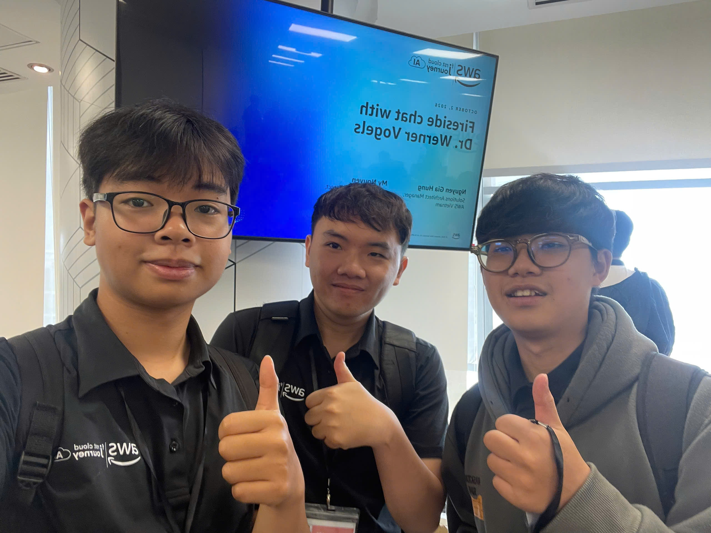

# Event Summary Report: “Fireside Chat with Dr. Werner”

- **Event Name:** Fireside Chat with Dr. Werner  
- **Date & Time:** 08:30 – 12:00, October 2, 2026  
- **Location:** 26th Floor, Bitexco Financial Tower, 2 Hai Trieu Street, District 1, Ho Chi Minh City, Vietnam  
- **Role:** Attendee  

### Event Objectives

- Hear firsthand perspectives from Amazon CTO Dr. Werner Vogels on cloud computing, artificial intelligence, and where technology is heading next.
- Draw practical lessons from designing, building, and operating systems at global scale.
- Examine how innovation, technical leadership, and emerging trends shape enterprise digital transformation.
- Participate in interactive Q&A and connect with students, software engineers, architects, and industry builders.

### Speakers

- **Dr. Werner Vogels** – Chief Technology Officer (CTO), Amazon.com

### Key Highlights

#### Perspectives from Amazon CTO Dr. Werner Vogels

- Gained direct insights from a pioneering cloud architect and one of the most influential leaders in modern computing.
- Connected foundational cloud engineering principles with current shifts in AI and digital transformation.

#### Global-Scale Systems, Innovation & Leadership

- Explored real-world lessons on scaling systems globally while maintaining reliability and adaptability.
- Reflected on engineering leadership, innovation culture, and how organizations prepare for next-generation technology waves.

#### Interactive Q&A & Community Networking

- Took part in open Q&A and peer discussions around Cloud, AI, and building resilient software systems.
- Connected with a diverse mix of students, software engineers, developers, solutions architects, DevOps engineers, data engineers, and AI practitioners.

### Key Takeaways

#### Large-Scale Systems & Architecture

- **Thinking beyond single features to global scale**: Focusing on how systems behave, evolve, and stay resilient in production at large scale rather than viewing features in isolation.
- **Linking Cloud fundamentals with AI evolution**: Treating cloud architecture and AI capabilities as complementary layers within broader digital transformation.

#### Leadership, Innovation & Community Exchange

- **Learning from seasoned engineering leaders**: Hearing from an experienced CTO illustrates how pragmatic engineering discipline pairs with long-term innovation.
- **Broadening perspective across engineering roles**: Exchanging ideas with peers from different backgrounds—students to architects—expands how technical trade-offs are evaluated.

### Applying to Work

- **Prioritize scale, resilience, and operability early**: Keep large-scale reliability and operational trade-offs in mind when designing or testing cloud architectures.
- **Connect Cloud foundations with AI workflows**: Integrate cloud fundamentals with AI capabilities instead of studying them as disconnected topics.
- **Stay active in technical communities**: Join Q&A sessions and peer conversations across roles to sharpen practical problem-solving.

### Event Experience

Taking part in **“Fireside Chat with Dr. Werner”** at Bitexco Financial Tower was a standout moment to hear directly from Amazon CTO Dr. Werner Vogels alongside fellow builders. Key aspects of my experience included:

#### Learning from a Cloud Pioneer
- Hearing Dr. Werner Vogels discuss cloud computing, AI, innovation, leadership, and global-scale systems made large-scale engineering concepts much more tangible and inspiring.
- The conversation clarified how foundational technology shifts translate into durable system architecture and digital transformation.

#### Diverse Community Perspectives
- Being in the room with students, developers, solutions architects, DevOps and data engineers, and AI practitioners fostered an open, energetic exchange of viewpoints.
- Interactive Q&A helped connect big-picture architectural ideas with concrete questions from builders on the ground.

#### Core Lessons Learned
- Operating systems at global scale requires aligning architecture, innovation, and technical leadership rather than relying on any single tool.
- Engaging actively in Q&A and community discussions turns high-level talks into practical takeaways for personal growth.

#### Event Photos

> Overall, the session delivered inspiring insights from Dr. Werner Vogels on global-scale systems, Cloud, AI, and innovation, while strengthening my connection with the wider builder community.
