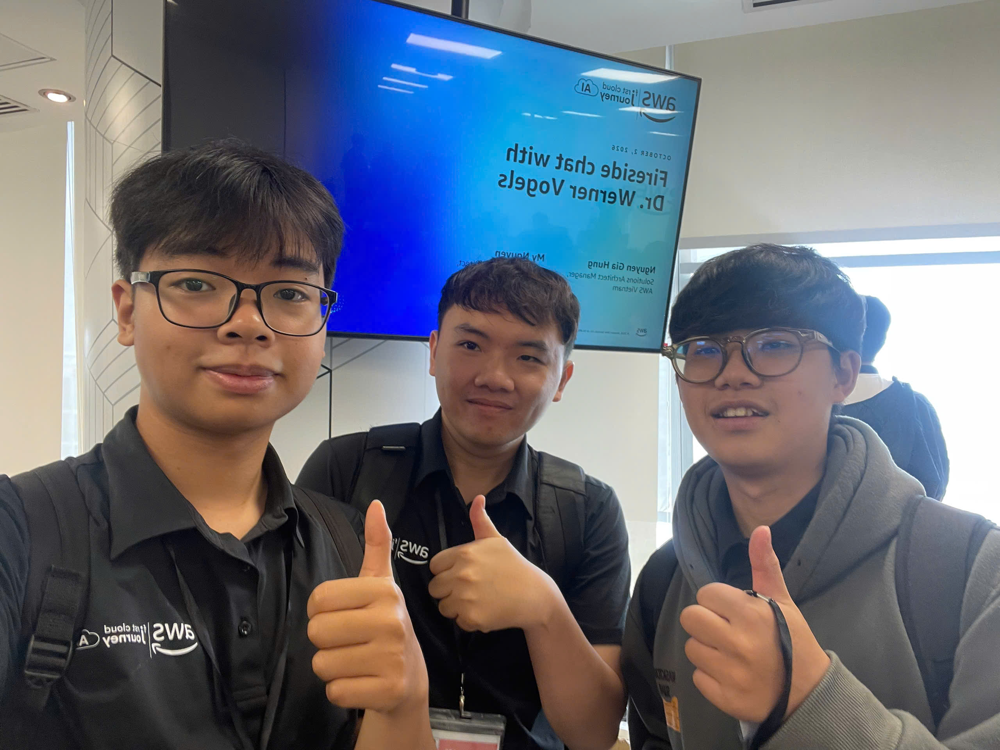

# Báo cáo tổng kết sự kiện: “Fireside Chat with Dr. Werner”

- **Tên sự kiện:** Fireside Chat with Dr. Werner  
- **Thời gian:** 08:30 – 12:00, Thứ Sáu, ngày 02/10/2026  
- **Địa điểm:** Tầng 26, Tòa nhà Bitexco Financial Tower, Số 2 Hải Triều, Quận 1, TP. Hồ Chí Minh, Việt Nam  
- **Vai trò:** Người tham dự  

### Mục tiêu sự kiện

- Lắng nghe chia sẻ trực tiếp từ CTO của Amazon, Dr. Werner Vogels, về điện toán đám mây, trí tuệ nhân tạo và hướng đi tương lai của công nghệ.
- Rút ra bài học thực tế từ việc thiết kế, xây dựng và vận hành các hệ thống ở quy mô toàn cầu.
- Tìm hiểu cách tư duy đổi mới sáng tạo, vai trò lãnh đạo kỹ thuật và các xu hướng công nghệ định hình quá trình chuyển đổi số.
- Tham gia hỏi đáp tương tác và giao lưu, kết nối cùng sinh viên, lập trình viên, kiến trúc sư giải pháp, kỹ sư và cộng đồng làm công nghệ.

### Diễn giả

- **Dr. Werner Vogels** – Chief Technology Officer (CTO), Amazon.com

### Điểm nổi bật

#### Góc nhìn trực tiếp từ CTO Amazon – Dr. Werner Vogels

- Tiếp nhận chia sẻ thực tế từ một trong những nhà lãnh đạo công nghệ có ảnh hưởng lớn và là người tiên phong đặt nền móng cho cloud hiện đại.
- Gắn kết các nguyên lý cốt lõi của điện toán đám mây với những chuyển dịch mới trong AI và chuyển đổi số.

#### Hệ thống Quy mô Toàn cầu, Đổi mới & Lãnh đạo Kỹ thuật

- Khám phá kinh nghiệm thực tế về mở rộng và duy trì độ ổn định của hệ thống ở quy mô toàn cầu.
- Chiêm nghiệm về tư duy lãnh đạo kỹ thuật, văn hóa đổi mới và cách tổ chức chuẩn bị cho làn sóng công nghệ tiếp theo.

#### Hỏi đáp Tương tác & Giao lưu Cộng đồng

- Tham gia đặt câu hỏi và trao đổi trực tiếp xoay quanh Cloud, AI và cách xây dựng hệ thống bền vững.
- Kết nối với cộng đồng đa dạng gồm sinh viên, software engineers, developers, solution architects, DevOps engineers, data engineers và AI practitioners.

### Bài học cốt lõi

#### Hệ thống & Kiến trúc ở Quy mô Lớn

- **Tư duy toàn cầu vượt ra ngoài một tính năng đơn lẻ**: Nhìn nhận cách hệ thống vận hành, thích ứng và duy trì độ tin cậy ở quy mô lớn thay vì chỉ tập trung vào từng tính năng riêng lẻ.
- **Kết nối nền tảng Cloud với sự phát triển của AI**: Đặt kiến thức nền tảng về cloud gắn liền với sự tiến hóa của AI và chuyển đổi số để nhìn thấy bức tranh hệ thống toàn diện.

#### Lãnh đạo, Đổi mới & Trao đổi Cộng đồng

- **Học hỏi từ lãnh đạo kỹ thuật dày dạn kinh nghiệm**: Lắng nghe chia sẻ từ một CTO giàu kinh nghiệm giúp thấy rõ cách kỷ luật kỹ thuật thực dụng hòa quyện với đổi mới sáng tạo.
- **Mở rộng góc nhìn qua trao đổi đa vai trò**: Góc nhìn từ sinh viên đến kỹ sư và kiến trúc sư giúp nhìn nhận bài toán kỹ thuật đa chiều hơn.

### Áp dụng vào công việc thực tế

- **Ưu tiên quy mô, tính bền vững và khả năng vận hành từ sớm**: Giữ tư duy về khả năng mở rộng, tính ổn định và vận hành thực tế khi thiết kế kiến trúc hoặc làm lab trên cloud.
- **Gắn kết kiến thức Cloud với các luồng AI**: Nhìn nhận cloud và AI như những thành phần bổ trợ cho nhau thay vì tách rời riêng lẻ.
- **Chủ động tham gia cộng đồng và phiên Q&A**: Tích cực trao đổi, đặt câu hỏi cùng người làm kỹ thuật ở nhiều vai trò để rèn tư duy giải quyết vấn đề.

### Trải nghiệm cá nhân

Tham dự buổi **“Fireside Chat with Dr. Werner”** tại Bitexco Financial Tower là một dịp đáng nhớ khi được lắng nghe trực tiếp CTO của Amazon, Dr. Werner Vogels, cùng giao lưu với cộng đồng những người xây dựng công nghệ. Những trải nghiệm nổi bật gồm:

#### Học hỏi từ người tiên phong trong lĩnh vực Cloud
- Các chia sẻ của Dr. Werner Vogels về cloud, AI, đổi mới sáng tạo, lãnh đạo và hệ thống quy mô toàn cầu giúp các khái niệm về hệ thống lớn trở nên gần gũi và dễ hình dung hơn.
- Buổi trò chuyện mang lại nhiều góc nhìn sâu sắc về cách xu hướng công nghệ định hình kiến trúc hệ thống dài hạn và chuyển đổi số.

#### Góc nhìn đa chiều từ cộng đồng
- Không gian quy tụ sinh viên, lập trình viên, kiến trúc sư giải pháp, kỹ sư DevOps/dữ liệu và người làm AI tạo nên bầu không khí trao đổi cởi mở và giàu năng lượng.
- Phiên Q&A tương tác giúp nối liền các góc nhìn kiến trúc vĩ mô với những câu hỏi thực tế của người làm kỹ thuật.

#### Bài học rút ra
- Xây dựng và vận hành hệ thống ở quy mô lớn đòi hỏi nhìn đồng bộ cả kiến trúc, đổi mới sáng tạo lẫn cách tổ chức và lãnh đạo, thay vì phụ thuộc vào một công cụ đơn lẻ.
- Chủ động tham gia Q&A và kết nối cộng đồng giúp chuyển hóa những buổi chia sẻ tầm nhìn thành bài học cụ thể cho quá trình tự phát triển.

#### Hình ảnh tại sự kiện

> Nhìn chung, buổi fireside chat mang lại những góc nhìn truyền cảm hứng từ Dr. Werner Vogels về hệ thống quy mô toàn cầu, Cloud, AI và đổi mới sáng tạo, đồng thời giúp mình mở rộng kết nối với cộng đồng công nghệ.
