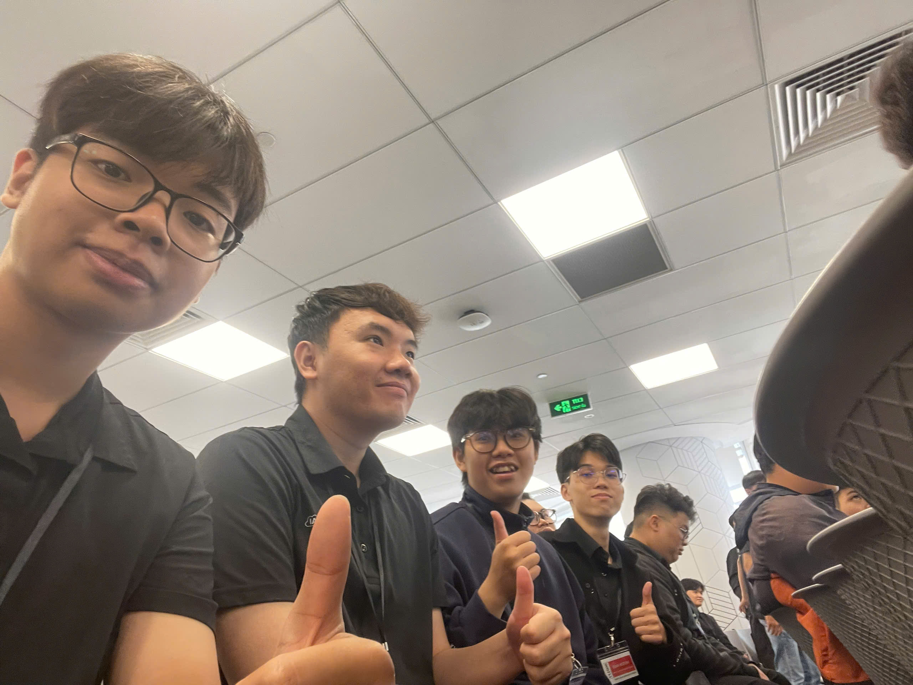

# Event Summary Report: “First Cloud AI Journey: Weekly Meet Up”

- **Event Name:** First Cloud AI Journey: Weekly Meet Up  
- **Date & Time:** 09:00 – 12:00, October 24, 2026  
- **Location:** 26th Floor, Bitexco Financial Tower, 2 Hai Trieu Street, District 1, Ho Chi Minh City, Vietnam  
- **Role:** Attendee  

### Event Objectives

- Gain practical cloud and AI agent engineering lessons directly from practicing tech leads and industry engineers.
- Examine real-world patterns spanning low-latency Vietnamese Voice AI, cross-account resource sharing, shift-left security testing, and production AI agent platforms.
- Connect insights on cost efficiency, context/memory lifecycle management, security guardrails, and continuous 24/7 agent operations to my study roadmap.
- Build greater confidence in networking, proactive outreach, and consistent learning within the AWS builder community.

### Speakers

- **Kiet Tran** – Revve AI
- **Long Huynh** – Styl Solution
- **Thinh Nguyen** – Styl Solution
- **Xuan An** – Leader, AWS Student Builder Group HCMUTE
- **Khoa Kieu** – Tech Lead, ACB
- **Nghi Danh** – AWS Community Builder

### Key Highlights

#### 1. Hear, Think, Speak – Building a Vietnamese Voice-AI Contact Center on AWS (Kiet Tran, Revve AI)

- Examined a **Voice AI** architecture engineered to bring conversational latency down to roughly **1.8 seconds**.
- Showcased a live demonstration where an AI voice agent placed a phone call to conduct a screening interview in Vietnamese for a **Cloud Engineer** candidate.

#### 2. AWS Resource Access Manager (Long Huynh, Styl Solution)

- Shared practical approaches to sharing resources safely across accounts within an **AWS Organization** to lower costs and centralize networking.
- Emphasized pairing **IAM policies** with **Service Control Policies (SCPs)** so accounts and identities never exceed their defined permission boundaries.

#### 3. AWS Pentest with AWS Continuum / Security Agent (Thinh Nguyen, Styl Solution)

- Presented an early infrastructure security workflow combining **Terraform** code reviews and automated checks inside **GitLab/GitHub** pull requests to catch misconfigurations early.
- Demonstrated a **Security Agent** simulating real user behavior to execute automated penetration testing on **SIT/UAT** environments prior to production release.

#### 4. Amazon Bedrock AgentCore (Xuan An, Leader of AWS Student Builder Group HCMUTE)

- Offered a structured breakdown of two core capabilities for running AI agents in production:
  - **Agent Runtime**: Executes **MicroVMs** on **EC2 Spot** instances to keep compute costs lean.
  - **Memory**: Combines synchronous **Short-term** memory with asynchronous **Long-term** memory so agents retain deeper user context over time.

#### 5. Kiro Crew (Khoa Kieu, Tech Lead at ACB; Nghi Danh, AWS Community Builder)

- My standout session of the morning, focusing on running AI agents **24/7** to assist with code review and operational checks, followed by a lively technical Q&A covering:
  - **Artifacts**: Automatically gathering live job listings and rendering statistical charts inline within the chat interface.
  - **Context Window Management**: Applying **Auto Compact** around **70–90%** context utilization and using **“Break down context”** to inspect token usage per component.
  - **Memory & Guardrails**: Pruning stale memory to prevent cost creep, while enforcing security guardrails that block autonomous infrastructure deletion or exposure of server secrets and credentials.

### Key Takeaways

#### Multi-Account Governance & Shift-Left Security

- **Permission ceilings across shared accounts**: Pairing **IAM policies** with **SCPs** alongside cross-account resource sharing enables cost savings and centralized network governance without weakening permission boundaries.
- **Early risk detection before production**: Reviewing **Terraform** in pull requests and running automated **Security Agent** testing on **SIT/UAT** surfaces security issues well before live deployment.

#### Production Agents, Cost Control & Guardrails

- **Cost-aware runtime and layered memory**: Deploying agents to production benefits from running **MicroVMs** on **EC2 Spot** and pairing synchronous short-term memory with asynchronous long-term memory.
- **Sustaining 24/7 operations safely**: Managing context windows (**Auto Compact**, **Break down context**), clearing outdated memory, and enforcing guardrails keeps continuous agent workloads cost-predictable and prevents accidental resource destruction or credential leaks.

### Application to My Work

- **Combine IAM policies with SCPs**: Enforce explicit permission guardrails when sharing resources across accounts in an **AWS Organization**.
- **Shift security checks left**: Integrate **Terraform** pull-request reviews and automated **SIT/UAT** testing into delivery workflows before production rollout.
- **Govern agent context, memory, and guardrails**: Monitor token budgets, prune aging memory, and apply strict guardrails protecting infrastructure, secrets, and credentials.
- **Practice proactive networking and study habits**: Push myself to be more confident in networking, proactive in connecting with speakers and peers, and stay disciplined in daily technical study.

### Event Experience

Spending Saturday morning (October 24, 2026) on the 26th floor of Bitexco Financial Tower for the **“First Cloud AI Journey: Weekly Meet Up”** was energizing and packed with hands-on engineering lessons from tech leads and practitioners working on Cloud and AI Agents. Notable parts of my experience included:

#### Learning from Practitioners & Tech Leads
- Talks from speakers representing **Revve AI**, **Styl Solution**, **AWS Student Builder Group HCMUTE**, **ACB**, and the **AWS Community Builder** network grounded cloud and AI architectures in real-world trade-offs.
- **Kiro Crew** was especially memorable for me, particularly the Q&A on **Artifacts**, **Auto Compact**, **Break down context**, memory cleanup, and guardrails for **24/7** AI agents.

#### Hands-On Architectural Insights
- Explored concrete engineering patterns including low-latency **Voice AI** (~1.8s response with a live Vietnamese **Cloud Engineer** screening call demo), **AWS Resource Access Manager** with **IAM** and **SCPs**, **Terraform** PR reviews and **SIT/UAT** **Security Agent** pentesting, and **Amazon Bedrock AgentCore** (**Agent Runtime** on **EC2 Spot** MicroVMs and tiered **Memory**).

#### Community & Personal Growth
- Sharing the room at Bitexco with speakers, organizers, and fellow learners gave me strong momentum in my Cloud and AI journey.
- The session encouraged me to step out of my comfort zone, build confidence in networking, and connect more proactively with the community.

#### Lessons Learned
- Practical Cloud and AI Agent systems require balancing responsiveness and context depth with cost control and firm guardrails.
- Running AI agents continuously (**24/7**) depends on disciplined context/memory management and security guardrails that prevent infrastructure deletion or secret/credential leaks.
- Confident networking, proactive engagement, and steady study habits are key to sustaining progress in my cloud learning path.

#### Event Photos

> In short, the meet-up delivered rich, practical engineering insights across five strong sessions—ranging from low-latency Voice AI and multi-account governance to shift-left pentesting and 24/7 agent guardrails—while inspiring me to network and learn more proactively.
