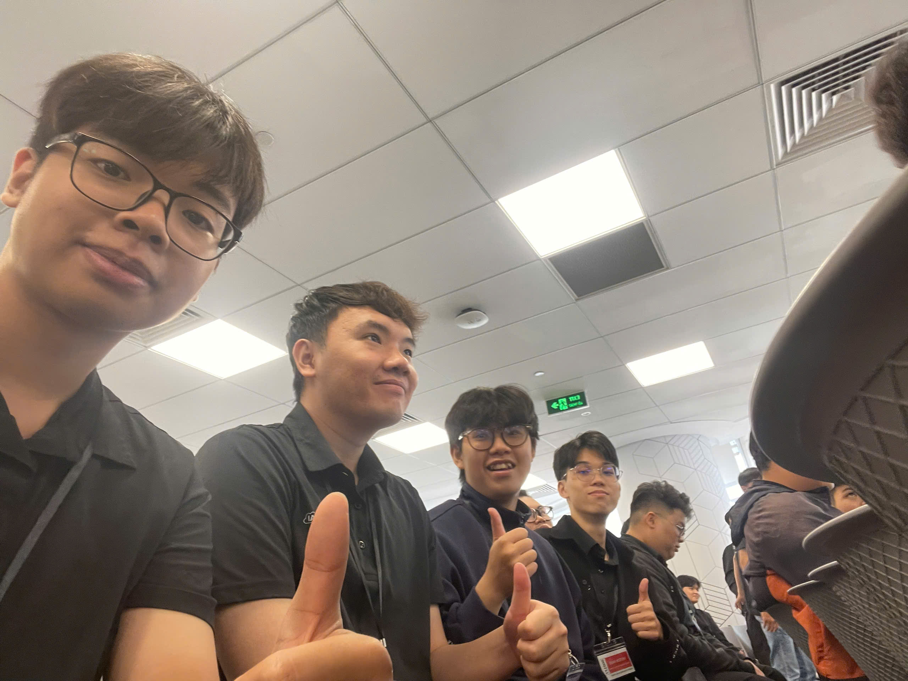

# Báo cáo tổng kết sự kiện: “First Cloud AI Journey: Weekly Meet Up”

- **Tên sự kiện:** First Cloud AI Journey: Weekly Meet Up  
- **Thời gian:** 09:00 – 12:00, Thứ Bảy, ngày 24/10/2026  
- **Địa điểm:** Tầng 26, Tòa nhà Bitexco Financial Tower, Quận 1, TP. Hồ Chí Minh  
- **Vai trò:** Người tham dự  

### Mục tiêu sự kiện

- Tiếp thu kinh nghiệm triển khai thực tế về Cloud và AI Agents trực tiếp từ các Tech Lead và kỹ sư đang làm việc tại doanh nghiệp.
- Khám phá các mô hình thực tế xoay quanh Voice AI tiếng Việt độ trễ thấp, chia sẻ tài nguyên đa tài khoản, kiểm thử bảo mật sớm và nền tảng vận hành AI Agent trên production.
- Gắn kết các bài học về tối ưu chi phí, quản trị context/memory, lớp chặn bảo mật và vận hành agent 24/7 với kế hoạch học tập cá nhân.
- Tăng cường sự tự tin khi giao lưu, chủ động kết nối và duy trì nhịp độ học tập đều đặn trong cộng đồng.

### Diễn giả

- **Anh Kiệt Trần** – Revve AI
- **Anh Long Huỳnh** – Styl Solution
- **Anh Thịnh Nguyễn** – Styl Solution
- **Anh Xuân An** – Leader AWS Student Builder Group HCMUTE
- **Anh Khoa Kiều** – Tech Lead ACB
- **Anh Nghi Danh** – AWS Community Builder

### Điểm nổi bật

#### 1. Hear, Think, Speak – Xây dựng tổng đài Voice-AI tiếng Việt trên AWS (Anh Kiệt Trần – Revve AI)

- Phân tích kiến trúc **Voice AI** tối ưu độ trễ phản hồi xuống xấp xỉ **~1.8s** để duy trì sự tự nhiên trong hội thoại.
- Minh họa qua bản live demo hệ thống AI gọi điện trực tiếp phỏng vấn sơ tuyển vị trí **Cloud Engineer** bằng tiếng Việt trôi chảy.

#### 2. AWS Resource Access Manager (Anh Long Huỳnh – Styl Solution)

- Chia sẻ cách chia sẻ tài nguyên an toàn giữa các tài khoản trong **AWS Organization** nhằm tối ưu chi phí và tập trung hóa quản lý mạng.
- Nhấn mạnh việc kết hợp chặt chẽ **IAM policy** cùng **SCP** để thiết lập trần quyền hạn rõ ràng cho từng tài khoản và thực thể.

#### 3. AWS Pentest with AWS Continuum / Security Agent (Anh Thịnh Nguyễn – Styl Solution)

- Giới thiệu quy trình đánh giá an toàn hạ tầng từ sớm: rà soát code **Terraform** ngay trên **GitLab/GitHub PR** để phát hiện lỗi sớm.
- Sử dụng **Security Agent** mô phỏng hành vi người dùng thật để kiểm thử xâm nhập (pentest) tự động trên môi trường **SIT/UAT** trước khi đưa lên production.

#### 4. Amazon Bedrock AgentCore (Anh Xuân An – Leader AWS Student Builder Group HCMUTE)

- Cung cấp góc nhìn hệ thống về hai thành phần trọng tâm khi đưa AI Agent lên production:
  - **Agent Runtime**: Khởi chạy **MicroVM** trên **EC2 Spot** nhằm tối ưu chi phí hạ tầng tính toán.
  - **Memory**: Kết hợp bộ nhớ **Short-term** đồng bộ và **Long-term** bất đồng bộ giúp Agent nắm bắt ngữ cảnh người dùng sâu hơn.

#### 5. Kiro Crew (Anh Khoa Kiều – Tech Lead ACB & Anh Nghi Danh – AWS Community Builder)

- Phiên chia sẻ mình tâm đắc nhất về cách vận hành AI Agent **24/7** hỗ trợ review code và kiểm tra hệ thống, đi kèm phần hỏi đáp kỹ thuật sôi nổi:
  - **Artifacts**: Tự động thu thập dữ liệu việc làm thực tế và vẽ biểu đồ thống kê trực quan ngay trong cửa sổ chat.
  - **Quản trị Context Window**: Kích hoạt **Auto Compact** khi ngữ cảnh đạt **70–90%** và dùng **Break down context** để bóc tách lượng token tiêu thụ của từng thành phần.
  - **Quản lý Memory & Guardrails**: Xóa bớt các memory cũ để tránh đội chi phí, đồng thời thiết lập lớp guardrails ngăn AI tự ý xóa hạ tầng hoặc làm lộ secret/credential của máy chủ.

### Bài học chính

#### Quản trị Đa tài khoản & Kiểm thử Bảo mật Sớm

- **Giữ vững trần quyền hạn khi chia sẻ tài nguyên**: Phối hợp **IAM policy** với **SCP** khi chia sẻ tài nguyên trong **AWS Organization** giúp tiết kiệm chi phí, quản lý mạng tập trung và kiểm soát chặt chẽ phạm vi quyền.
- **Phát hiện rủi ro trước khi triển khai thật**: Rà soát **Terraform** trên **GitLab/GitHub PR** và pentest tự động bằng **Security Agent** ở **SIT/UAT** giúp xử lý lỗ hổng sớm.

#### Vận hành Agent trên Production, Chi phí & Guardrails

- **Runtime linh hoạt và bộ nhớ đa tầng**: Vận hành Agent trên production gắn với chạy **MicroVM** trên **EC2 Spot** để giảm chi phí và dùng **Short-term** đồng bộ kết hợp **Long-term** bất đồng bộ để lưu ngữ cảnh dài hạn.
- **Kiểm soát chi phí và an toàn khi chạy 24/7**: Quản trị context window (**Auto Compact**, **Break down context**), dọn dẹp memory cũ và bật guardrails giúp kiểm soát chi phí và ngăn nguy cơ xóa nhầm hạ tầng hay lộ secret/credential.

### Áp dụng vào công việc thực tế

- **Áp dụng đồng thời IAM policy và SCP**: Thiết lập trần quyền hạn khi chia sẻ tài nguyên giữa các tài khoản trong **AWS Organization**.
- **Đưa kiểm tra bảo mật vào sớm**: Thực hiện review **Terraform** trên PR và chạy pentest tự động ở **SIT/UAT** trước khi lên production.
- **Kiểm soát chặt context, memory và guardrails của Agent**: Theo dõi lượng token, dọn memory cũ và thiết lập rào cản bảo vệ hạ tầng, secret và credential.
- **Chủ động kết nối và rèn luyện đều đặn**: Tự tin hơn khi giao lưu, chủ động trao đổi với diễn giả/bạn học và duy trì sự kỷ luật trong học tập.

### Trải nghiệm cá nhân

Buổi meet-up sáng Thứ Bảy ngày 24/10/2026 tại tầng 26 Bitexco Financial Tower diễn ra trong khung giờ ngắn (9:00 – 12:00 AM) nhưng để lại nhiều góc nhìn thực tiễn và nguồn năng lượng tích cực từ các chia sẻ của Tech Lead và kỹ sư về Cloud và AI Agent. Những trải nghiệm chính gồm:

#### Học hỏi từ các Tech Lead và diễn giả
- Các phần trình bày từ **Revve AI**, **Styl Solution**, **AWS Student Builder Group HCMUTE**, **ACB** và cộng đồng **AWS Community Builder** giúp mình thấy bức tranh triển khai thực tế phong phú và sát với bài toán doanh nghiệp.
- **Kiro Crew** là phiên mình ấn tượng nhất, đặc biệt ở phần hỏi đáp kỹ thuật về tạo **Artifacts**, **Auto Compact**, **Break down context**, dọn memory và thiết lập **Guardrails** cho Agent vận hành **24/7**.

#### Tiếp cận kiến trúc và thực tế triển khai
- Được tìm hiểu các bài toán cụ thể: giảm độ trễ **Voice AI** xuống **~1.8s** với live demo phỏng vấn sơ tuyển **Cloud Engineer** bằng tiếng Việt, **AWS Resource Access Manager** đi cùng **IAM** và **SCP**, kiểm tra **Terraform** trên PR và pentest tự động trên **SIT/UAT**, cùng **Amazon Bedrock AgentCore** (**Agent Runtime** trên **EC2 Spot** MicroVM và kiến trúc phân tầng **Memory**).

#### Kết nối và tinh thần cộng đồng
- Không khí trao đổi cởi mở tại tầng 26 Bitexco cùng diễn giả, ban tổ chức và các bạn học mang lại nhiều động lực cho hành trình học Cloud và AI của mình.
- Sau buổi gặp gỡ, mình nhận thấy bản thân cần tự tin giao lưu hơn, chủ động kết nối hơn và học tập kiên trì hơn nữa.

#### Bài học kinh nghiệm
- Hệ thống Cloud và AI Agent thực tế cần sự cân bằng giữa hiệu năng xử lý (độ trễ hội thoại, ngữ cảnh sâu), chi phí vận hành và các lớp bảo vệ an toàn.
- Khi vận hành AI Agent liên tục hoặc **24/7**, quản lý context/memory và thiết lập guardrails chống xóa hạ tầng hay rò rỉ secret/credential là điều kiện tiên quyết.
- Sự tự tin kết nối, tính chủ động và sự kiên trì học hỏi sẽ giúp mình đi xa và vững vàng hơn trên con đường Cloud.

#### Hình ảnh tại sự kiện

> Tóm lại, buổi meet-up mang lại lượng kiến thức thực tế rất giá trị qua 5 phiên chia sẻ—từ Voice AI và quản trị đa tài khoản đến kiểm thử bảo mật sớm và guardrails cho Agent—đồng thời tạo động lực để mình tự tin kết nối và học hỏi chủ động hơn.
