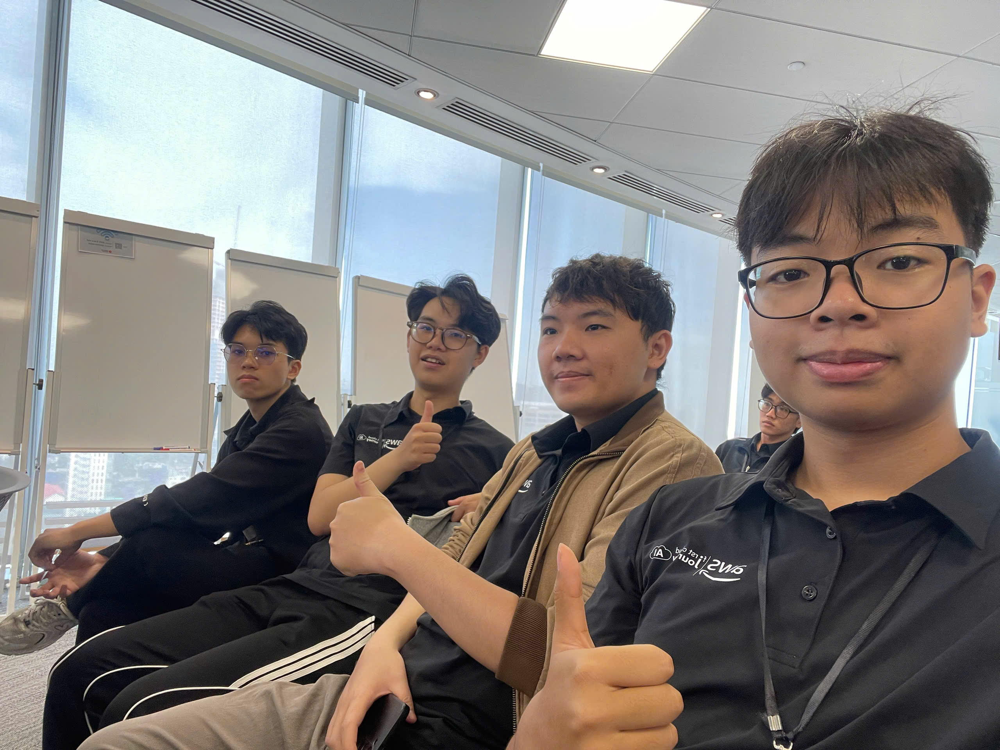

# Event Summary Report: “First Cloud AI Journey: Weekly Meet Up 14/11”

- **Event Name:** First Cloud AI Journey: Weekly Meet Up 14/11
- **Date:** November 14, 2026
- **Location:** AWS Vietnam Office, Ho Chi Minh City, Vietnam
- **Speakers:** Nguyễn Lâm Anh, Trần Phương Huyền, Phúc Khang, Huỳnh An Khương, Nguyễn Quốc Bảo (AWS First Cloud Journey – FCJ Members)
- **Organizers:** AWS First Cloud Journey (FCJ) & AWS Study Group
- **Role:** Attendee

### Event Objectives

- Understand how enterprise AI agents move from early prototypes into secure, reliable, and scalable production systems.
- Examine core architectural patterns behind **Amazon Bedrock AgentCore**, including inbound/outbound authorization, short-term and long-term memory, and **Multi-AZ** AWS infrastructure.
- Connect insights on inference cost control, tool access boundaries, and runtime observability to my cloud and AI security learning roadmap.
- Actively participate in community technical discussions, Q&A, and interactive quizzes to reinforce practical engineering concepts.

### Key Highlights

#### 1. From Prototype to Production: Secure, Reliable, Scalable Enterprise AI on the Cloud

- Highlighted that building a working AI chatbot prototype is only the starting point; operating enterprise AI agents in production demands disciplined engineering across real workloads.
- Focused on three core operational pillars:
  - **Performance & Cost Optimization**: Balancing responsive agent execution with controlled model inference and infrastructure expenses as request volume scales.
  - **System Integration & Access Control**: Enabling agents to interact with business applications and external tools while enforcing clear permission boundaries against unauthorized actions.
  - **Monitoring & Quality Evaluation**: Tracking agent reasoning paths and tool invocations while verifying that generated outputs and actions meet quality expectations.

#### 2. Designing Scalable Solutions with Amazon Bedrock AgentCore

- Explored how **Amazon Bedrock AgentCore** supports enterprise-scale environments spanning hundreds of agents, thousands of tools, hundreds of MCP servers, and over 100,000 tenants.
- **Inbound & Outbound Authentication and Authorization**:
  - Introduced a reusable **Universal 5-Step Skeleton** for securing interactions through **Bedrock AgentCore Gateway** and **AgentCore Identity**.
  - Required authentication (such as **JWT** or **IAM** credentials) on incoming requests before agents access external tools or MCP servers, establishing controlled communication across users, agents, and connected services.
- **Context & Conversation Lifecycle with AgentCore Memory**:
  - **Short-term Memory**: Retains conversation messages and session state synchronously to preserve context during active interactions.
  - **Long-term Memory**: Extracts and organizes useful insights asynchronously across prior interactions into structured categories:
    - **Semantic**: Factual knowledge and meaningful information learned from conversations.
    - **User Preferences**: Individual user habits and preferences.
    - **Summarization**: Concise summaries of earlier interactions.
    - **Episodic**: Records of past tasks and experiences that guide future actions.
- **Production-Grade AWS Infrastructure**:
  - Covered deploying workloads across multiple Availability Zones (**Multi-AZ**) for high availability and fault tolerance.
  - Highlighted separating public and private subnets, configuring load balancing, building an agent orchestration layer, and embedding end-to-end observability.

### Key Takeaways

#### Enterprise Readiness Beyond Prototypes

- **Security and governance from day one**: Production AI agents require explicit identity/gateway controls, structured memory lifecycles, and continuous monitoring rather than ad-hoc prototype scripts.
- **Cost and permission discipline**: Controlling inference/infrastructure spend and restricting tool access boundaries prevent runaway costs and unintended side effects at scale.

#### Scalable AgentCore & Multi-AZ Foundations

- **Tiered memory and controlled tool access**: Pairing synchronous short-term memory with asynchronous long-term memory—alongside **JWT/IAM** authentication and the **Universal 5-Step Skeleton**—supports rich context without losing access control.
- **Resilient multi-AZ architecture**: Combining **Amazon Bedrock AgentCore** with **Multi-AZ** networking, load balancing, orchestration, and observability builds a durable foundation for high-scale agent workloads.

### Application to My Work

- **Enforce strict boundaries on AI/agent workflows**: Apply least-privilege access controls, authenticated tool/MCP boundaries, and guardrails/observability when designing AI-assisted security and cloud systems.
- **Design for context lifecycles and cost efficiency**: Structure session state vs. long-term memory deliberately while keeping compute and model usage predictable.
- **Stay engaged with AWS community sessions**: Keep learning emerging AWS services and architectural patterns through hands-on sessions and discussions with peers and speakers.

### Event Experience

Attending the **“First Cloud AI Journey: Weekly Meet Up 14/11”** session at the AWS Vietnam office in Ho Chi Minh City gave me a clear look into taking **Amazon Bedrock Agents** and **Amazon Bedrock AgentCore** from prototype thinking to production-ready architecture. Notable parts of my experience included:

#### Deep Dive into Production AI Agents
- Discussing the real engineering gap between a working demo and an enterprise agent handling heavy traffic, strict permissions, and quality checks.
- Exploring how **AgentCore Gateway**, **AgentCore Identity**, and the **Universal 5-Step Skeleton** structure safe access to tools and MCP servers.

#### Memory & Multi-AZ Architecture
- Comparing synchronous **Short-term Memory** against asynchronous **Long-term Memory** (**Semantic**, **User Preferences**, **Summarization**, and **Episodic**).
- Reviewing **Multi-AZ** AWS infrastructure patterns—public/private subnets, load balancing, orchestration, and observability—for large-scale deployments.

#### Community Interaction & Quizzes
- Following technical Q&A on restricting production agent permissions, managing costs, and preparing for Cloud and AI roles.
- Participating in the end-of-session interactive quiz covering Gateway authorization, AgentCore memory, and Multi-AZ setup, alongside the introduction of **AWS Student Community Day Vietnam 2026**.

#### Lessons Learned
- Enterprise AI agents demand strong access boundaries, structured memory, and observability from the outset.
- Combining **Amazon Bedrock AgentCore** with resilient **Multi-AZ** AWS architecture supports high scale and reliability.
- Active participation in community sessions and quizzes helps turn conceptual AWS features into practical engineering habits.

#### Event Photos

> In short, the November 14 weekly meet-up offered a practical look at moving from AI prototypes to production systems with Amazon Bedrock AgentCore—covering Gateway/Identity authorization, short- and long-term memory, and Multi-AZ infrastructure while building momentum toward AWS Student Community Day Vietnam 2026.
