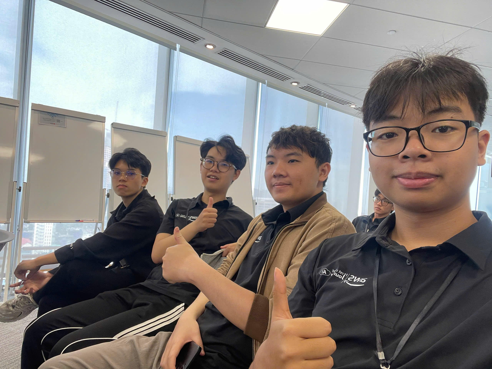

# Báo cáo tổng kết sự kiện: “First Cloud AI Journey: Weekly Meet Up 14/11”

- **Tên sự kiện:** First Cloud AI Journey: Weekly Meet Up 14/11
- **Thời gian:** 14/11/2026
- **Địa điểm:** Văn phòng AWS Việt Nam, TP. Hồ Chí Minh, Việt Nam
- **Diễn giả:** Nguyễn Lâm Anh, Trần Phương Huyền, Phúc Khang, Huỳnh An Khương, Nguyễn Quốc Bảo (Thành viên AWS First Cloud Journey – FCJ)
- **Đơn vị tổ chức:** AWS First Cloud Journey (FCJ) & AWS Study Group
- **Vai trò:** Người tham dự

### Mục tiêu sự kiện

- Hiểu rõ cách các AI agent cấp doanh nghiệp chuyển dịch từ bản mẫu thử nghiệm (prototype) sang hệ thống vận hành thực tế an toàn, tin cậy và mở rộng tốt.
- Nắm bắt các mô hình kiến trúc cốt lõi đằng sau **Amazon Bedrock AgentCore**, gồm xác thực/phân quyền luồng vào – ra, bộ nhớ ngắn hạn – dài hạn và hạ tầng AWS **Multi-AZ**.
- Liên kết các góc nhìn về tối ưu chi phí suy diễn, kiểm soát quyền truy cập công cụ và khả năng quan sát (observability) vào lộ trình học tập Cloud & AI Security.
- Tích cực tham gia thảo luận kỹ thuật, hỏi đáp và quiz tương tác cùng cộng đồng để củng cố kiến thức thực hành.

### Điểm nhấn chính

#### 1. Từ Prototype đến Production: AI Doanh nghiệp An toàn, Tin cậy và Mở rộng tốt trên Cloud

- Nhấn mạnh rằng dựng được một bản demo chatbot hoạt động mới chỉ là bước đầu; đưa AI agent vào môi trường doanh nghiệp thực tế đòi hỏi quy trình kỹ thuật bài bản hơn nhiều.
- Tập trung vào ba trụ cột vận hành chính:
  - **Tối ưu hiệu năng & chi phí**: Cân bằng tốc độ phản hồi của agent với việc kiểm soát chi phí suy diễn mô hình và hạ tầng khi lượng yêu cầu tăng lên.
  - **Tích hợp hệ thống & kiểm soát truy cập**: Cho phép agent tương tác với ứng dụng nghiệp vụ và công cụ bên ngoài nhưng vẫn giữ ranh giới phân quyền rõ ràng, tránh thao tác trái phép.
  - **Giám sát & đánh giá chất lượng**: Theo dõi luồng suy luận và cách agent gọi công cụ, đồng thời đánh giá xem kết quả sinh ra và hành động thực thi có đạt kỳ vọng hay không.

#### 2. Thiết kế giải pháp có khả năng mở rộng với Amazon Bedrock AgentCore

- Phân tích cách **Amazon Bedrock AgentCore** đáp ứng môi trường doanh nghiệp quy mô lớn với hàng trăm agent, hàng nghìn công cụ, hàng trăm MCP server và hơn 100.000 tenant.
- **Xác thực & phân quyền cho luồng vào và ra**:
  - Giới thiệu khung chuẩn có thể tái sử dụng (**Universal 5-Step Skeleton**) để kiểm soát tương tác qua **Bedrock AgentCore Gateway** và **AgentCore Identity**.
  - Yêu cầu xác thực luồng yêu cầu gửi vào (như **JWT** hoặc thông tin xác thực **IAM**) trước khi agent truy cập công cụ ngoài hoặc MCP server, tạo luồng giao tiếp có kiểm soát giữa người dùng, agent và dịch vụ kết nối.
- **Quản lý ngữ cảnh & hội thoại với AgentCore Memory**:
  - **Short-term Memory**: Giữ tin nhắn hội thoại và thông tin phiên làm việc theo luồng đồng bộ để duy trì ngữ cảnh trong phiên tương tác hiện tại.
  - **Long-term Memory**: Trích xuất và sắp xếp thông tin hữu ích theo luồng bất đồng bộ từ các tương tác trước đó vào các nhóm có cấu trúc:
    - **Semantic**: Kiến thức và thông tin có ý nghĩa rút ra từ cuộc trao đổi.
    - **User Preferences**: Thói quen và sở thích riêng của từng người dùng.
    - **Summarization**: Bản tóm tắt ngắn gọn các hội thoại trước.
    - **Episodic**: Ghi nhận các tác vụ và trải nghiệm trước đó nhằm định hướng cho các hành động tiếp theo.
- **Hạ tầng AWS cấp độ Production**:
  - Đề cập việc triển khai qua nhiều Availability Zone (**Multi-AZ**) để tăng tính sẵn sàng và khả năng chịu lỗi.
  - Nhấn mạnh tách biệt public/private subnet, cân bằng tải, tầng điều phối agent và tích hợp observability xuyên suốt hệ thống.

### Bài học rút ra

#### Sẵn sàng cho Production vượt ra ngoài Prototype

- **Bảo mật và quản trị ngay từ đầu**: AI agent trên production cần cơ chế phân quyền qua Gateway/Identity, quản lý vòng đời bộ nhớ rõ ràng và giám sát liên tục thay vì chỉ dừng ở mức prototype.
- **Kỷ luật về chi phí và ranh giới quyền**: Kiểm soát chi phí suy diễn/hạ tầng và giới hạn quyền truy cập công cụ giúp tránh đội chi phí và các hành động ngoài ý muốn ở quy mô lớn.

#### Nền tảng AgentCore & Multi-AZ có khả năng mở rộng

- **Bộ nhớ phân tầng và luồng truy cập kiểm soát chặt**: Kết hợp bộ nhớ ngắn hạn đồng bộ với bộ nhớ dài hạn bất đồng bộ — cùng xác thực **JWT/IAM** và **Universal 5-Step Skeleton** — giúp giữ ngữ cảnh phong phú mà vẫn kiểm soát được quyền.
- **Hạ tầng Multi-AZ bền vững**: Kết hợp **Amazon Bedrock AgentCore** với mạng **Multi-AZ**, cân bằng tải, tầng điều phối và observability tạo nền tảng vững chắc cho các hệ thống agent quy mô lớn.

### Ứng dụng vào công việc

- **Thiết lập ranh giới quyền chặt chẽ cho luồng AI/agent**: Áp dụng nguyên tắc ít quyền nhất (least privilege), kiểm soát truy cập công cụ/MCP và cơ chế giám sát/guardrail khi xây dựng các hệ thống bảo mật và cloud có tích hợp AI.
- **Tổ chức vòng đời ngữ cảnh và tối ưu chi phí**: Phân tách rõ trạng thái phiên với bộ nhớ dài hạn đồng thời giữ chi phí tính toán và gọi mô hình ở mức dễ dự đoán.
- **Duy trì nhịp sinh hoạt cùng cộng đồng AWS**: Tiếp tục cập nhật dịch vụ AWS mới và mô hình kiến trúc thực tế qua các buổi chia sẻ và trao đổi cùng cộng đồng.

### Trải nghiệm sự kiện

Tham gia buổi **“First Cloud AI Journey: Weekly Meet Up 14/11”** tại văn phòng AWS Việt Nam ở TP. Hồ Chí Minh mang lại góc nhìn rõ ràng về cách đưa **Amazon Bedrock Agents** và **Amazon Bedrock AgentCore** từ ý tưởng prototype lên kiến trúc sẵn sàng cho production. Một số điểm đáng nhớ trong trải nghiệm của mình gồm:

#### Đi sâu vào AI Agent trên môi trường Production
- Trao đổi về khoảng cách kỹ thuật thực tế giữa một bản demo hoạt động được và một agent doanh nghiệp phải xử lý tải lớn, phân quyền chặt và đánh giá chất lượng đầu ra.
- Tìm hiểu cách **AgentCore Gateway**, **AgentCore Identity** và **Universal 5-Step Skeleton** kiểm soát an toàn việc kết nối tới công cụ và MCP server.

#### Kiến trúc Memory & Multi-AZ
- Đối chiếu **Short-term Memory** đồng bộ với **Long-term Memory** bất đồng bộ (**Semantic**, **User Preferences**, **Summarization** và **Episodic**).
- Xem xét các thành phần hạ tầng AWS **Multi-AZ** — tách subnet public/private, load balancing, orchestration và observability — cho bài toán triển khai quy mô lớn.

#### Tương tác cộng đồng & Quiz
- Theo dõi phần hỏi đáp kỹ thuật xoay quanh việc giới hạn quyền của agent trên production, quản lý chi phí và định hướng cơ hội mảng Cloud & AI.
- Tham gia phần quiz tương tác cuối buổi ôn lại phân quyền Gateway, bộ nhớ AgentCore và triển khai Multi-AZ, cũng như lắng nghe giới thiệu về **AWS Student Community Day Vietnam 2026**.

#### Bài học rút ra
- Hệ thống AI agent doanh nghiệp cần ranh giới quyền, bộ nhớ có cấu trúc và khả năng quan sát ngay từ thiết kế ban đầu.
- Kết hợp **Amazon Bedrock AgentCore** với hạ tầng **Multi-AZ** giúp tăng độ sẵn sàng và khả năng mở rộng.
- Tham gia đều đặn các buổi meet-up và quiz giúp biến kiến thức AWS thành thói quen kỹ thuật thực tế.

#### Hình ảnh sự kiện

> Tóm lại, buổi weekly meet-up ngày 14/11 mang đến nhiều góc nhìn thực tế về hành trình đưa AI từ prototype lên production với Amazon Bedrock AgentCore — từ xác thực qua Gateway/Identity, bộ nhớ ngắn hạn/dài hạn đến hạ tầng Multi-AZ — đồng thời tạo thêm động lực hướng tới AWS Student Community Day Vietnam 2026.
